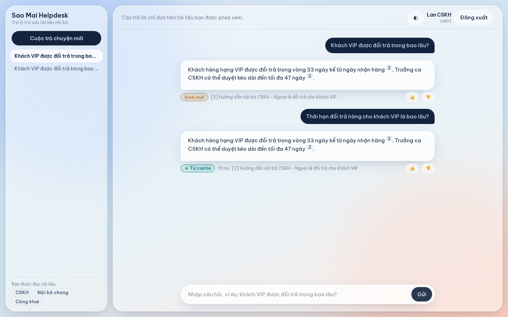

# Permission-Aware Semantic Cache cho RAG tài liệu nội bộ

Hệ thống hỏi đáp (RAG) trên tài liệu nội bộ **có phân quyền**, có **semantic cache** để trả lời ngay các câu hỏi lặp lại mà **không làm rò rỉ** thông tin giữa những người có quyền khác nhau. Mở rộng từ PermRAG (Jeong & Lee, IEEE Access 2025): giữ ý tưởng "kiểm tra quyền bằng IAM gốc", thêm lớp cache và các cơ chế đồng bộ khi quyền hoặc tài liệu thay đổi.



## Ý tưởng chính
- **Cache chia theo access signature:** signature của user là mã hash của tập collection user đó được đọc (theo IAM). Hai user chỉ dùng chung cache khi đọc được **đúng cùng** một tập tài liệu, nên không rò rỉ và cũng không trả lời thiếu.
- **Provenance:** mỗi câu trả lời trong cache ghi lại nó được sinh từ đoạn tài liệu nào, version nào. Khi tài liệu bị sửa, entry tương ứng bị loại.
- **Đồng bộ quyền:** đọc admin events của Keycloak. Khi quyền thay đổi, signature của user bị tính lại và user chuyển sang partition đúng. Ngoài ra còn có TTL dự phòng và bước IAM kiểm tra lại khi hit.
- **Retrieval lọc trước theo quyền** thay vì lọc sau như PermRAG, sau đó IAM vẫn kiểm tra lần cuối.
- **Console vận hành:** xem từng request (HIT/MISS, vì sao, chunk nào, bao nhiêu token), metric, sự kiện bảo mật, và audit rò rỉ bằng canary.

## Chạy nhanh
```bash
cp .env.example .env            # điền OPENAI_API_KEY, GEMINI_API_KEY
make venv                       # cài Python + Node deps (1 lần)
make infra-up && make setup     # Docker hạ tầng + cấu hình Keycloak + nạp dữ liệu
make dev-backend                # terminal 1  -> http://localhost:8000
make dev-frontend               # terminal 2  -> http://localhost:5173
```
Đăng nhập bằng `cskh1` / `demo1234` (Chat) hoặc `admin_ops` / `demo1234` (Console). Chi tiết xem [docs/RUNNING.md](docs/RUNNING.md).

| Tài khoản | Vai trò | Đọc được |
|---|---|---|
| `khach` | customer | Công khai |
| `cskh1`, `cskh2` | employee, cskh_agent | Công khai, Nội bộ chung, CSKH |
| `sales_bac` / `sales_nam` | employee, sales (`region=north/south`) | Công khai, Nội bộ chung, Kinh doanh miền Bắc / Nam |
| `hr1` | employee, hr | Công khai, Nội bộ chung, Nhân sự (mật) |
| `admin_ops` | employee, ops_admin | Công khai, Nội bộ chung + Console |

Muốn chạy toàn bộ trong Docker: `make infra-up && make app-up && make app-setup`.

## Tài liệu
| File | Nội dung |
|---|---|
| [docs/Description.md](docs/Description.md) | **Mô tả phần mềm**: bài toán, giải pháp, tính năng, quy mô |
| [docs/UseCases.md](docs/UseCases.md) | **Mô tả kịch bản sử dụng**: 6 use case, luồng chính / phát sinh, sơ đồ |
| [docs/Requirements.md](docs/Requirements.md) | **Đặc tả yêu cầu**: FR-01..FR-14, NFR-01..NFR-06 |
| [docs/Design.md](docs/Design.md) | **Thiết kế**: kiến trúc, package, lớp, dữ liệu, giao diện, triển khai |
| [docs/API.md](docs/API.md) | **API reference**: mọi endpoint REST + SSE, request/response mẫu |
| [docs/STATUS.md](docs/STATUS.md) | Đã làm gì, chưa làm gì, khác plan ở đâu, các phát hiện khi làm |
| [docs/RUNNING.md](docs/RUNNING.md) | Cài đặt, chạy, tài khoản demo, xử lý lỗi thường gặp |
| [docs/TESTING.md](docs/TESTING.md) | Cách thử tay từng kịch bản, unit test, smoke test, Playwright |
| [docs/WALKTHROUGH.md](docs/WALKTHROUGH.md) | **Đi theo từng câu hỏi qua mọi hàm**: input/output thật, luồng IAM Keycloak, danh mục hàm, các điểm chưa hợp lý |
| [docs/DICTIONARY.md](docs/DICTIONARY.md) | Từ điển khái niệm, biến, khoá lưu trữ, có ví dụ giá trị thật |
| [docs/ARCHITECTURE.md](docs/ARCHITECTURE.md) | Kiến trúc, luồng xử lý, mô hình dữ liệu, điều kiện cache hit |
| [docs/CONFIG.md](docs/CONFIG.md) | Ý nghĩa từng tham số cấu hình, prompt, classifier |

## Cấu trúc
```
backend/app/     FastAPI: pipeline, cache, access signature, IAM adapter, sync, tracing, audit
frontend/        React + TS + Tailwind: Chat (/chat) và Console (/console); e2e/ = Playwright
configs/         settings.yaml, prompts.yaml (toàn bộ prompt LLM), classifier.yaml
data/pilot/      10 tài liệu tiếng Việt, ACL, canary, bộ câu hỏi pilot
scripts/         setup_keycloak, seed, smoke_api, check_apis
tests/           unit test (pytest)
infra/           script khởi tạo Postgres
```

## Công nghệ
Python 3.12, FastAPI, Qdrant, Redis, Postgres, Keycloak 26 (Authorization Services), OpenAI `text-embedding-3-small`, Gemini `gemini-3.5-flash-lite`, React 18, Vite, Tailwind 4, Recharts, Playwright, Docker Compose.
