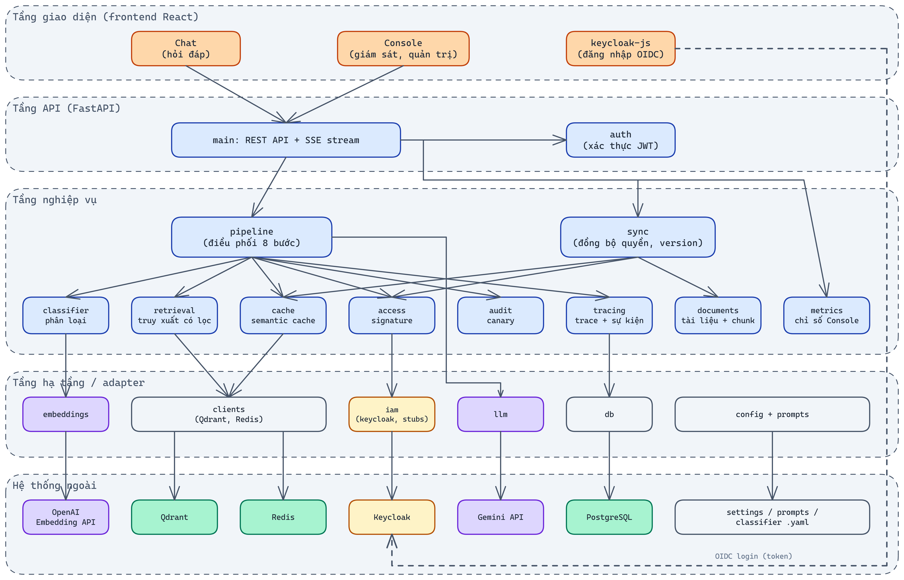
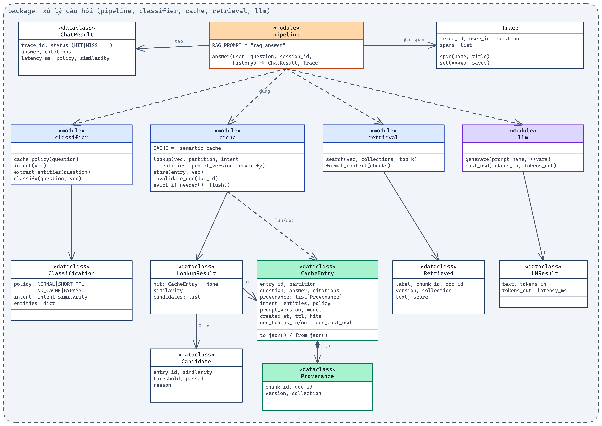
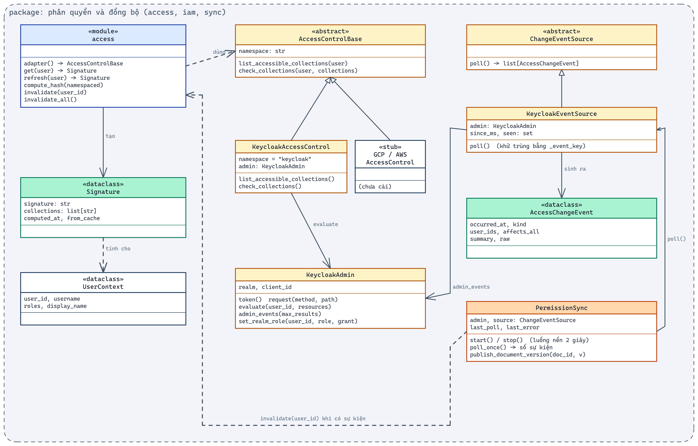
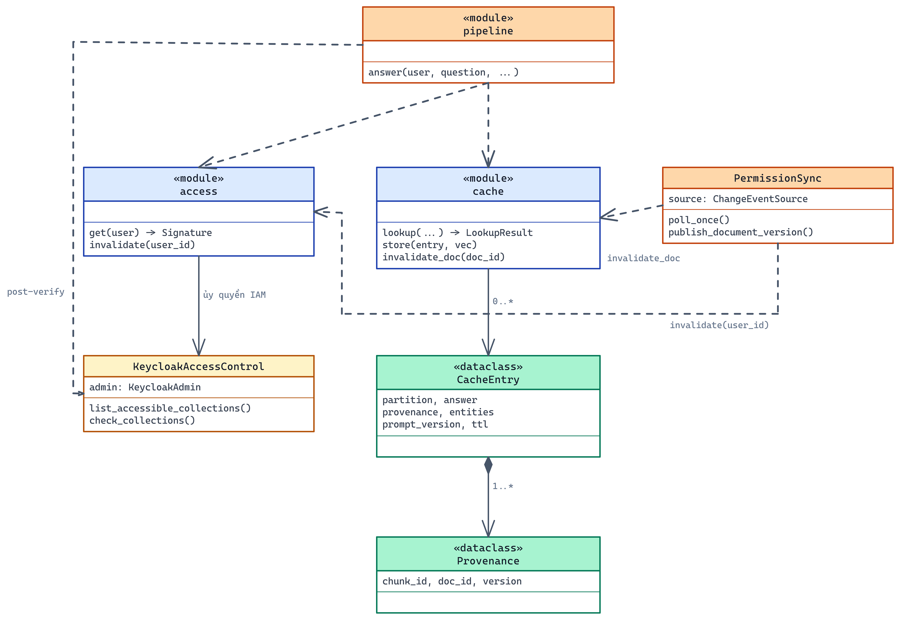

# Thiết kế hệ thống

## 1. Tổng quan thiết kế

Hệ thống gồm một frontend React và một backend FastAPI, cùng bốn dịch vụ hạ tầng chạy bằng Docker: Keycloak, Qdrant, Redis và PostgreSQL.

**Vì sao không dùng microservice?** Mọi bước xử lý một câu hỏi (signature → cache → truy xuất → IAM → LLM) nằm trên cùng một đường đi, và đề tài cần đo chính xác độ trễ của từng bước. Nếu tách thành nhiều service, độ trễ mạng giữa các service sẽ lẫn vào số đo. Phần phụ thuộc vào nhà cung cấp IAM được tách sau một adapter (`AccessControlBase`), nên khi thêm GCP hoặc AWS không phải sửa các module khác.

Frontend và backend dùng chung một phiên đăng nhập Keycloak. Chat (`/chat`) và Console (`/console`) là hai route của cùng một ứng dụng React.

---

## 2. Kiến trúc tổng thể



| Tầng | Package | Trách nhiệm |
|---|---|---|
| Giao diện | `frontend/src/pages/Chat.tsx`, `pages/console/*`, `auth.ts` | Chat, Console (5 tab), đăng nhập `keycloak-js` |
| API | `main.py`, `auth.py` | Endpoint REST và SSE; kiểm tra JWT, vai trò `ops_admin` |
| Nghiệp vụ | `pipeline`, `classifier`, `cache`, `retrieval`, `access`, `audit`, `tracing`, `documents`, `sync`, `metrics` | Pipeline 8 bước, đồng bộ quyền, chỉ số |
| Hạ tầng / adapter | `embeddings`, `llm`, `clients`, `db`, `iam/`, `config`, `prompts` | Bọc SDK bên ngoài và tệp cấu hình |
| Hệ thống ngoài | OpenAI, Gemini, Qdrant, Redis, Keycloak, PostgreSQL, `configs/*.yaml` | |

Phụ thuộc chỉ đi từ tầng trên xuống tầng dưới. Tầng nghiệp vụ không gọi SDK trực tiếp mà luôn đi qua tầng adapter.

---

## 3. Thiết kế thư mục

```text
src/
|-- backend/
|   |-- app/
|   |   |-- main.py          # FastAPI: endpoint Chat + Console, SSE
|   |   |-- auth.py          # Xác thực JWT Keycloak, kiểm tra ops_admin
|   |   |-- pipeline.py      # Điều phối 8 bước xử lý câu hỏi
|   |   |-- classifier.py    # NORMAL / SHORT_TTL / NO_CACHE / BYPASS, intent, entity
|   |   |-- cache.py         # Semantic cache: lookup 6 điều kiện, store, invalidate, LRU
|   |   |-- access.py        # Access signature
|   |   |-- retrieval.py     # Truy xuất Qdrant có lọc collection
|   |   |-- sync.py          # PermissionSync (admin events), xuất bản tài liệu
|   |   |-- audit.py         # Audit canary
|   |   |-- tracing.py       # Trace/span, Redis pub/sub
|   |   |-- documents.py     # Đọc, chia đoạn, nạp tài liệu
|   |   |-- metrics.py       # Truy vấn chỉ số cho Console
|   |   |-- embeddings.py, llm.py, clients.py, db.py, config.py, prompts.py, chunking.py
|   |   `-- iam/
|   |       |-- base.py      # AccessControlBase, ChangeEventSource, UserContext
|   |       |-- keycloak.py  # KeycloakAdmin, KeycloakAccessControl, KeycloakEventSource
|   |       `-- stubs.py     # GCPAccessControl, AWSAccessControl (khung)
|   `-- requirements.txt
|-- frontend/                # React + TS + Vite + Tailwind; e2e/ = Playwright
|-- configs/                 # settings.yaml, prompts.yaml, classifier.yaml
|-- data/pilot/              # docs/*.md, acl.yaml, canaries.yaml, questions.yaml
|-- scripts/                 # setup_keycloak, seed, smoke_api, check_apis, walkthrough/
|-- tests/                   # pytest
|-- infra/                   # init SQL cho Postgres
`-- docker-compose.yml
```

---

## 4. Thiết kế package

### 4.1 Package xử lý câu hỏi



Backend viết theo kiểu module chứa hàm, nên trong sơ đồ mỗi module được vẽ như một lớp có nhãn `«module»`, còn các kiểu dữ liệu được vẽ thành `«dataclass»`.

`pipeline.answer(user, question, session_id, history)` chạy 8 bước, mỗi bước là một span trong trace:

| # | Bước | Module | Kết quả |
|---|---|---|---|
| 1 | Danh tính và access signature | `access.get` | `Signature(signature, collections)` |
| 2 | Embedding câu hỏi (có cache theo nội dung) | `embeddings.embed_one` | vector 1536 chiều |
| 3 | Phân loại | `classifier.classify` | `Classification(policy, intent, entities)` |
| 4 | Tra cache trong partition | `cache.lookup` | `LookupResult(hit, similarity, candidates)` |
| 5 | Truy xuất có lọc (khi MISS) | `retrieval.search` | `list[Retrieved]` |
| 6 | IAM kiểm tra lại | `KeycloakAccessControl.check_collections` | loại đoạn bị từ chối |
| 7 | Sinh câu trả lời | `llm.generate("rag_answer")` | `LLMResult` |
| 8 | Lưu vào cache | `cache.store` | `CacheEntry` + provenance |

Sau khi trả lời: lưu trace vào Postgres, phát sự kiện `trace` qua Redis pub/sub, và chạy `audit.run` ở chế độ nền.

### 4.2 Package phân quyền và đồng bộ



- `AccessControlBase`: `list_accessible_collections(user)`, `check_collections(user, collections)`. `KeycloakAccessControl` cài đặt giao diện này bằng API `policy/evaluate`.
- `ChangeEventSource.poll()`: `KeycloakEventSource` đọc admin events, loại sự kiện trùng bằng `_event_key` và trả về `AccessChangeEvent`.
- `PermissionSync`: luồng nền, cứ 2 giây chạy `poll_once()` một lần, rồi gọi `access.invalidate(user_id)` hoặc `invalidate_all()` và ghi `security_events`.

Thêm IAM mới:

```python
class GCPAccessControl(AccessControlBase):
    namespace = "gcp"
    def list_accessible_collections(self, user) -> set[str]: ...
    def check_collections(self, user, collections) -> dict[str, bool]: ...
```

---

## 5. Thiết kế lớp



### CacheEntry

| Thuộc tính | Kiểu | Mô tả |
|---|---|---|
| `entry_id` | `str` | Mã entry |
| `partition` | `str` | Access signature của người tạo entry |
| `question`, `answer` | `str` | Câu hỏi gốc, câu trả lời |
| `citations` | `list[dict]` | Trích dẫn hiển thị |
| `provenance` | `list[Provenance]` | `chunk_id`, `doc_id`, `version`, `collection` đã dùng trong ngữ cảnh |
| `intent`, `entities` | `str`, `dict` | Chọn ngưỡng, kiểm tra thực thể |
| `policy`, `ttl` | `str`, `int` | NORMAL (604800 s) hoặc SHORT_TTL (3600 s) |
| `prompt_version`, `model` | `str` | Đổi prompt thì entry không còn dùng được |
| `gen_tokens_in/out`, `gen_cost_usd`, `gen_latency_ms` | `int`, `float` | Chi phí sinh câu trả lời, dùng để tính phần tiết kiệm |
| `hits`, `last_hit` | `int`, `float` | Số lần dùng lại, phục vụ LRU |

### Module `cache`

| Hàm | Mô tả |
|---|---|
| `lookup(vec, partition, intent, entities, prompt_version, reverify)` | Lấy 3 ứng viên gần nhất trong partition, kiểm tra 6 điều kiện, trả về entry đầu tiên đạt |
| `store(entry, vec)` | Lưu vector vào Qdrant, entry vào Redis, cập nhật reverse index và LRU |
| `invalidate_doc(doc_id)` | Xoá các entry có provenance chứa tài liệu này |
| `evict_if_needed()` | Loại entry theo LRU khi vượt `max_entries` |
| `flush()` | Xoá toàn bộ cache |

### Module `access`

| Hàm | Mô tả |
|---|---|
| `get(user)` | Đọc signature từ Redis, nếu chưa có thì gọi `refresh` |
| `refresh(user)` | Hỏi IAM, tính hash, lưu với TTL 300 giây |
| `compute_hash(namespaced)` | `sha256("v<scheme_version>\|" + ",".join(sorted(collections)))`, lấy 16 ký tự hex |
| `invalidate(user_id)` / `invalidate_all()` | Xoá signature |

### PermissionSync

| Thành phần | Mô tả |
|---|---|
| `source: ChangeEventSource` | Hiện là `KeycloakEventSource` |
| `last_poll`, `last_error` | Hiển thị qua `/api/health` |
| `start()` / `stop()` | Luồng nền (chu kỳ `event_poll_seconds`) |
| `poll_once()` | Đọc sự kiện, xoá signature, ghi sự kiện bảo mật |
| `publish_document_version(doc_id, version, actor)` | Hàm cấp module: nạp lại tài liệu, `invalidate_doc`, ghi sự kiện |

---

## 6. Thiết kế dữ liệu

| Nơi lưu | Khoá / bảng | Nội dung |
|---|---|---|
| Qdrant | `chunks` | Vector + nội dung đoạn tài liệu; payload `collection`, `doc_id`, `version` |
| Qdrant | `semantic_cache` | Vector câu hỏi đã cache; payload `partition` |
| Redis | `cache:entry:<id>` | `CacheEntry` JSON, có TTL |
| Redis | `cache:doc:<doc_id>` | Set: reverse index tài liệu → entry |
| Redis | `cache:lru` | Sorted set theo lần dùng gần nhất |
| Redis | `cache:stats` | Hash thống kê |
| Redis | `sig:user:<user_id>` | Signature + collections, TTL 300 giây |
| Redis | `sig:known` | Hash: signature gần nhất của từng người (hiển thị partition) |
| Redis | `doc:version` | Hash: phiên bản hiện tại của từng tài liệu |
| Redis | `emb:<model>:<sha1>` | Embedding đã tính |
| Redis | `semcache:events` | Kênh pub/sub cho SSE |
| PostgreSQL | `documents` | `doc_id`, `title`, `collection`, `version`, `updated_at` |
| PostgreSQL | `sessions`, `messages` | Phiên, tin nhắn (`trace_id`, `cache_status`, `citations`, `feedback`) |
| PostgreSQL | `traces` | Một dòng mỗi request: status, policy, intent, partition, similarity, latency, token, chi phí, `spans` JSONB, `audit` JSONB, `unauthorized`, `feedback` |
| PostgreSQL | `security_events` | `kind`, `source`, `occurred_at`, `detected_at`, `effective_at`, `summary`, `details` |

**Lý do phân bổ:** dữ liệu cần tìm theo độ tương đồng đặt ở Qdrant; dữ liệu nằm trên đường trả lời và cần TTL đặt ở Redis; dữ liệu lưu lâu và cần thống kê (p50/p95 bằng `percentile_cont`) đặt ở PostgreSQL.

---

## 7. Thiết kế giao diện

| Màn hình | Route | Thành phần chính |
|---|---|---|
| Chat | `/chat`, `/chat/:sessionId` | Danh sách phiên, collection được đọc, khung hội thoại có nhãn "Sinh mới" / "Từ cache", trích dẫn, 👍/👎 |
| Tổng quan | `/console` | 6 thẻ chỉ số, biểu đồ request theo phút, bảng độ trễ p50/p95, bảng theo intent |
| Request | `/console/requests`, `/console/requests/:id` | Bảng lọc theo trạng thái; trang chi tiết: dòng thời gian các span, bảng ứng viên cache, chi phí, audit, partition |
| Cache | `/console/cache` | Entry, partition, provenance, TTL còn lại, nút xoá cache |
| Bảo mật | `/console/security` | Dòng thời gian sự kiện quyền và tài liệu, request vượt quyền |
| Quản trị | `/console/admin` | Người dùng × vai trò (bấm để cấp/thu hồi), tài liệu × phiên bản, khôi phục dữ liệu demo |

Nguyên tắc thiết kế:

- Luôn cho người dùng thấy phạm vi quyền của mình.
- Phân biệt rõ câu trả lời từ cache và câu trả lời sinh mới.
- Mọi quyết định đều xem được lý do.
- Console cập nhật theo thời gian thực qua SSE.

Phong cách: liquid glass, nút bo tròn, có chế độ sáng và tối.

---

## 8. Triển khai

```text
docker compose (profile mặc định)        docker compose --profile app
  postgres:16.4-alpine   :5432             backend  (FastAPI)  :8000
  keycloak:26.0.7        :8080             frontend (nginx)    :5173
  qdrant:v1.12.4         :6333
  redis:7.4-alpine       :6379
```

- `make setup` cấu hình realm Keycloak từ `data/pilot/acl.yaml` và nạp tài liệu.
- Khi phát triển: `make dev-backend` + `make dev-frontend`. Khi trình diễn: `make app-up && make app-setup`.
- Secret (`OPENAI_API_KEY`, `GEMINI_API_KEY`, client secret Keycloak) nằm trong `.env`, đã được gitignore.
