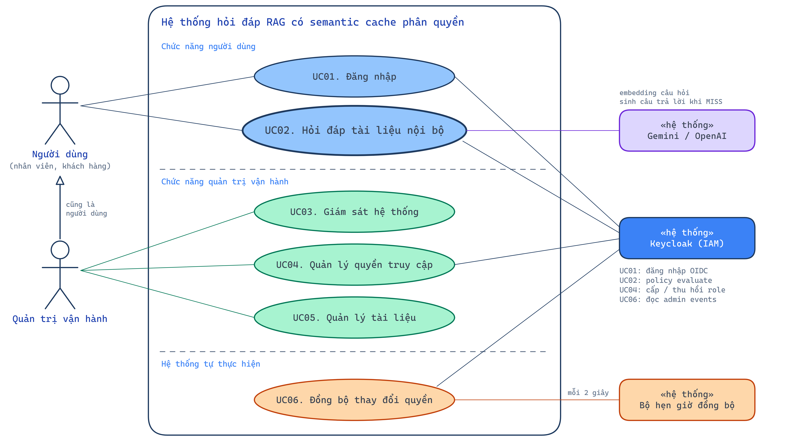
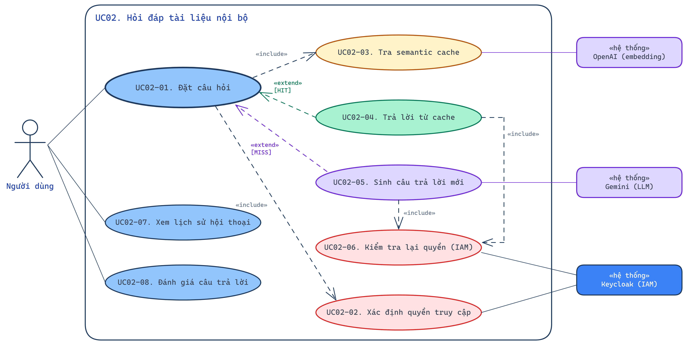
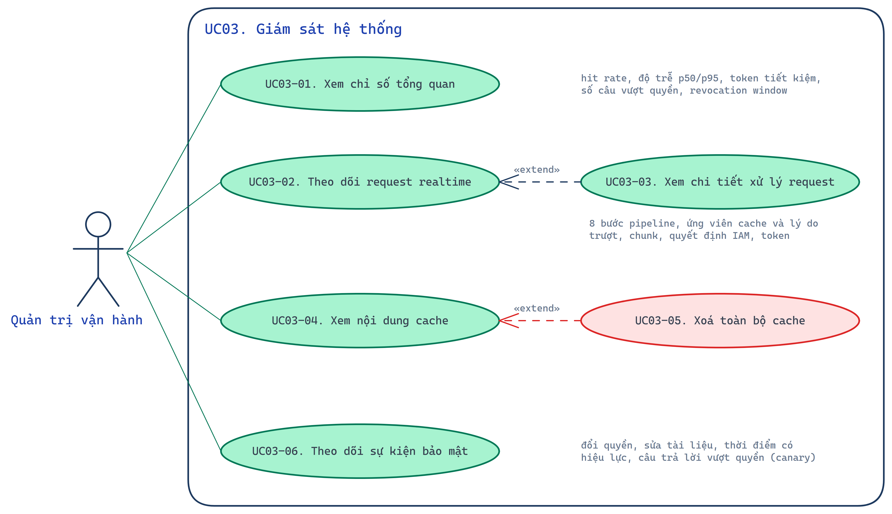
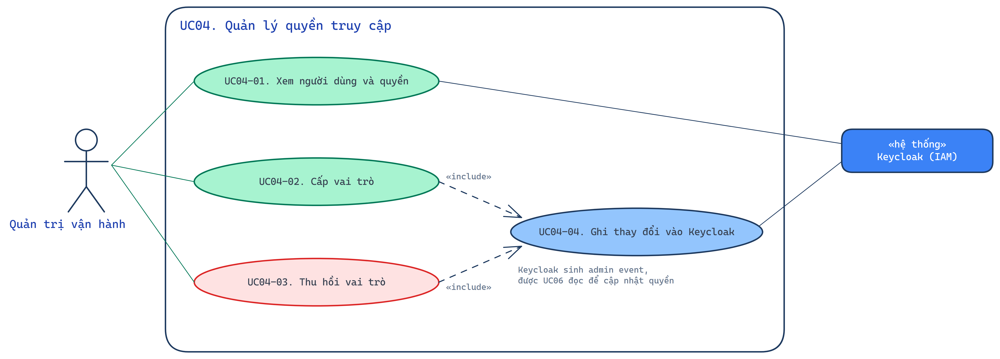
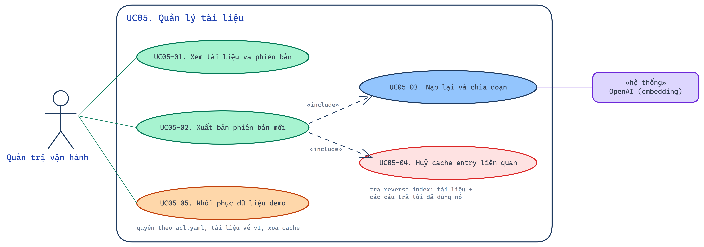
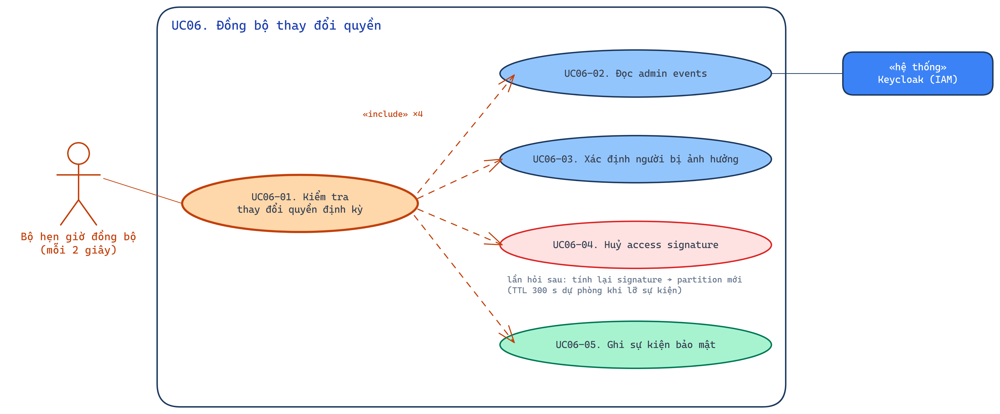
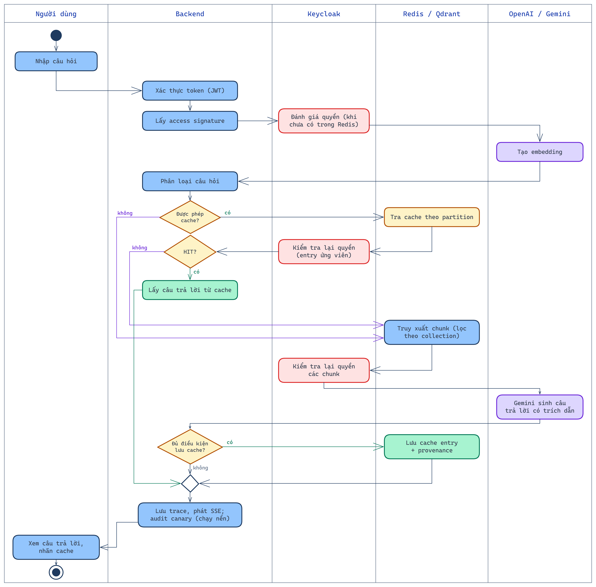
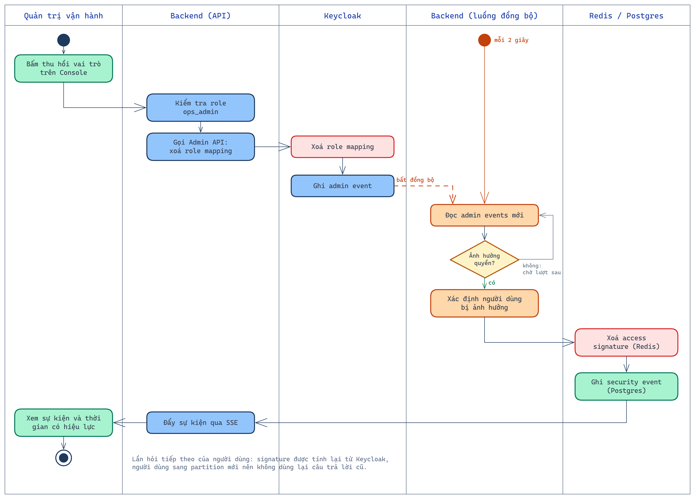

# Mô tả kịch bản sử dụng

## 1. Tổng quan

Tài liệu này mô tả các kịch bản sử dụng chính của hệ thống **Permission-Aware Semantic Cache**.

**Tác nhân con người**

- **Người dùng:** nhân viên các phòng ban hoặc khách hàng, hỏi đáp trên phần tài liệu mình được phép đọc.
- **Quản trị vận hành:** vai trò `ops_admin`. Đây cũng là một người dùng, nhưng có thêm quyền theo dõi hệ thống, quản lý quyền và quản lý tài liệu trên Console.

**Hệ thống ngoài**

- **Keycloak:** nguồn quyết định quyền duy nhất.
- **OpenAI / Gemini:** cung cấp embedding và LLM.
- **Bộ hẹn giờ đồng bộ:** luồng nền, cứ 2 giây đọc thay đổi quyền một lần.

---

## 2. Danh sách use case chính

| Mã | Tên use case | Tác nhân | Mô tả ngắn |
|---|---|---|---|
| UC01 | Đăng nhập | Người dùng, Keycloak | Đăng nhập OIDC; hệ thống xác định tập tài liệu được đọc. |
| UC02 | Hỏi đáp tài liệu nội bộ | Người dùng, Keycloak, OpenAI, Gemini | Đặt câu hỏi, nhận câu trả lời có trích dẫn, từ cache hoặc sinh mới. |
| UC03 | Giám sát hệ thống | Quản trị vận hành | Xem chỉ số, request theo thời gian thực, chi tiết xử lý, nội dung cache, sự kiện bảo mật. |
| UC04 | Quản lý quyền truy cập | Quản trị vận hành, Keycloak | Cấp hoặc thu hồi vai trò; thay đổi ghi vào Keycloak. |
| UC05 | Quản lý tài liệu | Quản trị vận hành, OpenAI | Xuất bản phiên bản tài liệu; hệ thống huỷ cache liên quan. |
| UC06 | Đồng bộ thay đổi quyền | Bộ hẹn giờ, Keycloak | Đọc admin events và huỷ access signature của người bị ảnh hưởng. |

---

## 3. UC01 - Đăng nhập

### Mô tả
Người dùng đăng nhập bằng tài khoản do Keycloak quản lý. Sau khi đăng nhập, hệ thống xác định người dùng được đọc những collection nào.

### Luồng chính
1. Người dùng mở `http://localhost:5173`.
2. Frontend (`keycloak-js`) chuyển hướng sang trang đăng nhập của Keycloak (OIDC, PKCE).
3. Người dùng nhập tên đăng nhập và mật khẩu (tài khoản demo: `cskh1` / `demo1234`).
4. Keycloak cấp access token và chuyển hướng về ứng dụng.
5. Frontend gọi `GET /api/me`. Backend kiểm tra chữ ký token, tính access signature và trả về vai trò cùng các collection được đọc.
6. Người có vai trò `ops_admin` được chuyển tới `/console`, người khác tới `/chat`.

### Luồng phát sinh
- Nhập sai mật khẩu: Keycloak báo lỗi.
- Token hết hạn: frontend tự làm mới token; nếu không làm mới được thì quay về trang đăng nhập.
- Người không có vai trò `ops_admin` mở `/console`: frontend hiển thị trang từ chối, backend trả `403`.

### Tiền điều kiện
- Keycloak đang chạy, realm `semcache` đã được cấu hình (`make keycloak`).

### Hậu điều kiện
- Trình duyệt giữ token hợp lệ. Signature của người dùng được lưu vào Redis (`sig:user:<id>`, TTL 300 giây).

---

## 4. UC02 - Hỏi đáp tài liệu nội bộ

### Mô tả
Đây là use case trọng tâm. Người dùng đặt câu hỏi; hệ thống trả lời từ cache nếu an toàn và đúng, nếu không thì sinh câu trả lời mới.

**Use case con:**

| Mã | Tên |
|---|---|
| UC02-01 | Đặt câu hỏi |
| UC02-02 | Xác định quyền truy cập (access signature) |
| UC02-03 | Tra semantic cache |
| UC02-04 | Trả lời từ cache (HIT) |
| UC02-05 | Sinh câu trả lời mới (MISS) |
| UC02-06 | Kiểm tra lại quyền với IAM |
| UC02-07 | Xem lịch sử hội thoại |
| UC02-08 | Đánh giá câu trả lời |

### Luồng chính
1. Người dùng nhập câu hỏi, frontend gọi `POST /api/chat`.
2. Backend xác thực token và lấy access signature: đọc từ Redis, nếu chưa có thì hỏi Keycloak.
3. Backend tạo embedding câu hỏi (OpenAI) và phân loại câu hỏi: chính sách cache, intent, thực thể.
4. Backend tìm tối đa 3 câu hỏi tương tự trong Qdrant `semantic_cache`, chỉ trong partition của người dùng.
5. Backend kiểm tra 6 điều kiện với từng ứng viên, trong đó có bước Keycloak xác nhận lại quyền.
6. Nếu có ứng viên thoả mãn, backend trả câu trả lời đã lưu (`status: "HIT"`).
7. Frontend hiển thị câu trả lời, trích dẫn và nhãn **"Từ cache"** kèm độ trễ.

### Luồng phát sinh
- **MISS:** backend truy xuất đoạn tài liệu với bộ lọc collection, Keycloak kiểm tra lại quyền, Gemini sinh câu trả lời có trích dẫn. Câu trả lời được lưu vào cache nếu có ngữ cảnh và có trích dẫn hợp lệ. Nhãn hiển thị là **"Sinh mới"**.
- **NO_CACHE:** câu hỏi cá nhân hoặc thời gian thực ("đơn hàng của tôi") được sinh mới và không lưu vào cache.
- **BYPASS:** câu hỏi nối tiếp ("thế còn hàng điện tử thì sao?") không tra cache và không lưu vào cache.
- **Không tìm thấy:** trả câu "Tôi không tìm thấy thông tin này trong các tài liệu bạn được phép truy cập." và không lưu vào cache.
- **Keycloak hoặc LLM lỗi:** quyền bị từ chối (fail-closed), backend trả `502`, trace vẫn được lưu với trạng thái `ERROR`.

### Kịch bản minh hoạ
| Người hỏi | Câu hỏi | Kết quả |
|---|---|---|
| `cskh1` | Khách VIP được đổi trả trong bao lâu? | MISS, "33 ngày… tối đa 47 ngày" (tài liệu CSKH) |
| `cskh2` (cùng quyền) | Thời hạn đổi trả hàng cho khách VIP là bao lâu? | HIT, similarity 0,847, ~20 ms |
| `khach` (ít quyền) | Khách VIP được đổi trả trong bao lâu? | MISS ở partition khác, "7 ngày" (tài liệu công khai); không lộ con số 33 |

### Tiền điều kiện
- Người dùng đã đăng nhập; tài liệu đã được nạp (`make seed`).

### Hậu điều kiện
- Tin nhắn, trace và (nếu đủ điều kiện) cache entry được lưu.
- Audit canary chạy nền và ghi kết quả vào trace.

---

## 5. UC03 - Giám sát hệ thống

### Mô tả
Quản trị viên theo dõi hiệu quả của cache và phát hiện sự cố bảo mật trên Console.

### Luồng chính
1. Quản trị viên mở `/console` (tab Tổng quan), frontend gọi `GET /api/console/metrics/overview`.
2. Console mở kết nối SSE `GET /api/console/stream?token=…` để nhận sự kiện `trace`, `audit`, `security`.
3. Ở tab Request, quản trị viên lọc theo trạng thái và chọn một request (`GET /api/console/traces/{id}`).
4. Trang chi tiết hiển thị từng span: signature, embedding, phân loại, bảng ứng viên cache kèm lý do đạt hoặc trượt, các đoạn tài liệu, quyết định của IAM, LLM, chi phí và audit.
5. Tab Cache và tab Bảo mật hiển thị nội dung cache và dòng thời gian sự kiện.

### Luồng phát sinh
- Người không có vai trò `ops_admin` gọi API Console: backend trả `403`.
- Xoá toàn bộ cache (`DELETE /api/console/cache`): mọi câu hỏi tiếp theo sẽ là MISS.
- Phát hiện câu trả lời vượt quyền: thẻ "Trả lời vượt quyền" chuyển sang màu cảnh báo và liệt kê các request liên quan.

### Tiền điều kiện
- Quản trị viên đăng nhập với vai trò `ops_admin` (`admin_ops` / `demo1234`).

### Hậu điều kiện
- Không thay đổi dữ liệu, trừ khi quản trị viên xoá cache.

---

## 6. UC04 - Quản lý quyền truy cập

### Mô tả
Quản trị viên cấp hoặc thu hồi vai trò của người dùng. Thay đổi được ghi vào Keycloak giống như khi thao tác trực tiếp trên Keycloak, nên đi qua đúng luồng đồng bộ thật (UC06).

### Luồng chính
1. Quản trị viên mở tab Quản trị, frontend gọi `GET /api/console/admin/users`.
2. Bảng hiển thị vai trò, thuộc tính và các collection mỗi người đọc được theo Keycloak tại thời điểm đó.
3. Quản trị viên bấm vào một vai trò để cấp hoặc thu hồi: `POST /api/console/admin/users/{username}/roles`.
4. Backend kiểm tra vai trò hợp lệ và gọi Admin API của Keycloak.
5. Keycloak sinh admin event. Backend **không** tự xoá signature ở bước này mà để UC06 xử lý.

### Luồng phát sinh
- Vai trò không hợp lệ: `400`.
- Quản trị viên tự thu hồi `ops_admin` của chính mình: `400`.
- Không tìm thấy người dùng: `404`.

### Tiền điều kiện
- Có vai trò `ops_admin`; vai trò cần gán có trong `acl.yaml`.

### Hậu điều kiện
- Vai trò trong Keycloak được cập nhật; sau khoảng 1–2 giây thay đổi có hiệu lực với cache.

---

## 7. UC05 - Quản lý tài liệu

### Mô tả
Quản trị viên xuất bản một phiên bản khác của tài liệu. Hệ thống nạp lại tài liệu và huỷ các câu trả lời đã sinh từ phiên bản cũ.

### Luồng chính
1. Quản trị viên mở bảng Tài liệu (`GET /api/console/admin/documents`).
2. Quản trị viên bấm "Xuất bản v2" cho `return_policy`: `POST /api/console/admin/documents/return_policy/publish {"version": 2}`.
3. Backend đọc tệp phiên bản mới, chia đoạn, tạo embedding và thay các đoạn cũ trong Qdrant.
4. Backend tra reverse index `cache:doc:return_policy` và xoá các entry liên quan.
5. Backend ghi sự kiện `doc_update` và đẩy sự kiện tới Console.

### Luồng phát sinh
- Phiên bản không tồn tại: `404`.
- Entry được tạo cùng lúc với lúc xuất bản nên không bị xoá: điều kiện 5 (phiên bản tài liệu) vẫn chặn việc dùng lại entry đó.
- Khôi phục dữ liệu demo (`POST /api/console/admin/reset`): vai trò về theo `acl.yaml`, tài liệu về phiên bản đầu, cache bị xoá.

### Hậu điều kiện
- Ví dụ thực tế: `return_policy: v1 -> v2 (4 chunk), xoá 4 cache entry`. Câu hỏi tiếp theo về đổi trả trả lời theo nội dung mới.

---

## 8. UC06 - Đồng bộ thay đổi quyền

### Mô tả
Một luồng nền định kỳ đọc admin events của Keycloak và huỷ access signature của những người bị ảnh hưởng, để thay đổi quyền có hiệu lực với cả cache.

### Luồng chính
1. Cứ 2 giây (`access.event_poll_seconds`), `PermissionSync` gọi `KeycloakEventSource.poll()` một lần.
2. Backend đọc admin events mới và loại sự kiện trùng bằng khoá ghép `_event_key`, vì Keycloak 26 không trả `id` cho admin event.
3. Backend xác định người bị ảnh hưởng: sự kiện `REALM_ROLE_MAPPING`, `GROUP_MEMBERSHIP`, `USER` ảnh hưởng một người; sự kiện `AUTHORIZATION_*` ảnh hưởng mọi người.
4. Backend xoá `sig:user:<id>` trong Redis.
5. Backend ghi `security_events` với 3 mốc thời gian `occurred_at`, `detected_at`, `effective_at` và đẩy sự kiện tới Console.
6. Ở lần hỏi tiếp theo, signature được tính lại và người dùng rơi vào partition mới.

### Luồng phát sinh
- Không đọc được Keycloak: ghi lỗi (`/api/health` → `sync_error`) và thử lại ở chu kỳ sau. Signature cũ tự hết hạn sau 300 giây, và bước IAM kiểm tra lại khi trả lời từ cache vẫn chặn quyền đã bị thu hồi.

### Hậu điều kiện
- Ví dụ thực tế: thu hồi `cskh_agent` của `cskh1`. Sau 0,3–1,9 giây, câu hỏi về khách VIP chỉ còn trả lời "7 ngày" theo tài liệu công khai.

---

## 9. Quy trình nghiệp vụ

| Quy trình hỏi đáp | Quy trình thu hồi quyền |
|---|---|
|  |  |
